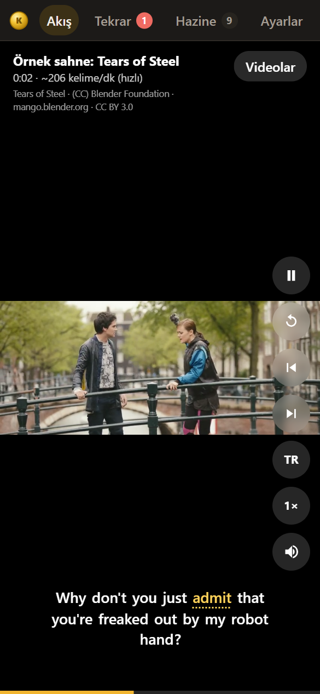
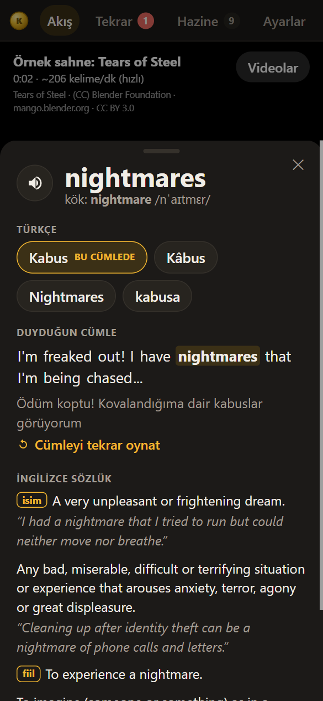
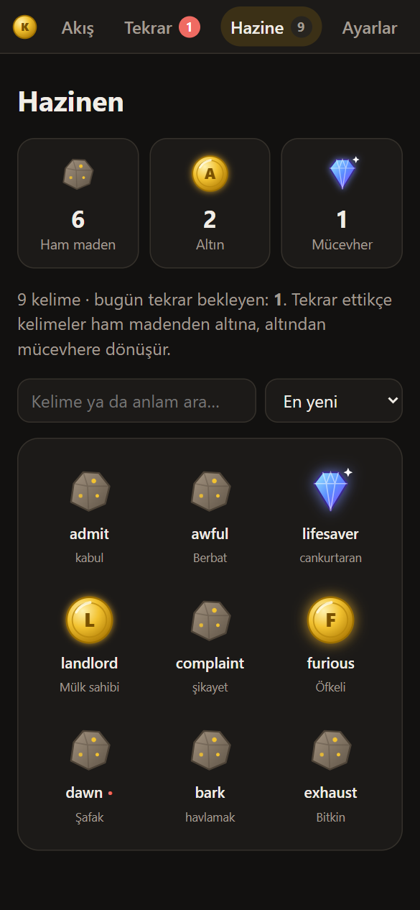
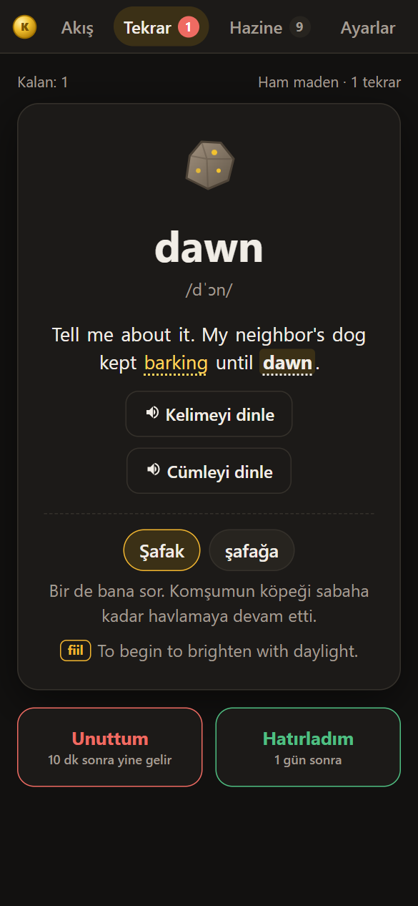

<div align="center">


# Kelime Avcısı

**Altyazılı videolardan İngilizce kelime yakala, aralıklı tekrarla öğren.**

[Uygulamayı aç →](https://emredevops37.github.io/kelime-avcisi/)

Kurulum yok, hesap yok. Telefonda ana ekrana yüklenir, internet olmadan da açılır.

<br>

<table>
  <tr>
    <td align="center"></td>
    <td align="center"></td>
    <td align="center"></td>
    <td align="center"></td>
  </tr>
  <tr>
    <td align="center"><b>İzle</b><br><sub>Klipleri kaydır</sub></td>
    <td align="center"><b>Dokun</b><br><sub>Cümledeki anlamı gör</sub></td>
    <td align="center"><b>Yakala</b><br><sub>Hazineni büyüt</sub></td>
    <td align="center"><b>Tekrarla</b><br><sub>Unutmadan önce hatırla</sub></td>
  </tr>
</table>

</div>

## Nasıl çalışır

1. **İzle.** Uzun videolar ~1 dakikalık kliplere bölünür. Telefonda kısa video uygulamaları gibi dikey kaydırırsın;
   her klipte konuşma hızı (kelime/dk) yazar.
2. **Dokun.** Altyazıda bilmediğin kelimeye dokun. Türkçe karşılıkları gelir ve **o cümlede** hangisinin kastedildiği
   işaretlenir. Cümlenin çevirisi, İngilizce tanımlar, kök kelime ve telaffuz da aynı kartta.
3. **Yakala.** Kelime, duyduğun cümle ve sahnesiyle birlikte hazinene girer. Artık her altyazıda altın renginde görünür.
4. **Tekrarla.** "Anlamını göster" → "Hatırladım / Unuttum". Aralıklar 1, 3, 7, 14, 30… gün diye uzar; tekrar ettikçe
   kelime **ham madenden altına, altından mücevhere** dönüşür. Sahneyi tekrar dinleyebilirsin.

## Ne izleyebilirim

| Kaynak | Nasıl |
|---|---|
| **YouTube** | **Videolar → YouTube linki ekle**, altyazıyı `.srt` olarak seç ya da videonun **"Transkripti göster"** metnini yapıştır. Android'de YouTube'da **Paylaş → Kelime Avcısı** da olur. |
| **Kendi videoların** | Videoyu ve aynı adlı İngilizce altyazıyı birlikte seç: `Bolum1.mp4` + `Bolum1.srt` (ya da `Bolum1.en.srt`). Videolar hiçbir yere yüklenmez. |
| **Yalnız altyazı** | Videosuz bir `.srt` de olur: cümleler zamanında gelir ve tarayıcının sesiyle okunur. |

Hemen denemek için **Örnekle dene**: *Tears of Steel* filminden altyazılı kısa bir sahne ve videosuz bir diyalog açılır.

<details>
<summary><b>Video ve altyazı ipuçları</b></summary>

- En sorunsuz biçim **MP4 (H.264 + AAC)**. HEVC görüntü ya da AC3 / E-AC3 / DTS ses Chrome'da oynamayabilir;
  uygulama bunu söyler. Sesi dönüştürmek için: `ffmpeg -i girdi.mkv -c:v copy -c:a aac cikti.mp4`
- Altyazı ayrı bir `.srt` / `.vtt` dosyası olmalı; videoya gömülü altyazı okunamaz. Türkçe ve diğer dillerdeki altyazılar atlanır.
- YouTube altyazısı otomatik çekilmez (YouTube buna yalnız kendi uygulamalarında izin veriyor).
  Sahibinin başka sitelerde oynatılmasını kapattığı videolar (bazı müzik klipleri gibi) çalışmaz.
- Chrome / Edge'de **Klasör seç** klasörü hatırlar; sonraki açılışta **Son klasörü aç** yeterli.

</details>

<details>
<summary><b>Bilgisayardaki videoları telefonda izle (aynı Wi-Fi)</b></summary>

1. Videoları ve altyazıları depodaki `videos/` klasörüne koy.
2. `baslat.bat`'a çift tıkla (Python gerekir). Pencere, telefonda açılacak adresi yazar: `http://192.168.x.x:8765/`
3. Telefonda bu adresi aç ve **Bilgisayardaki videolar**'a dokun. Videolar telefona kopyalanmadan oynar.

Windows güvenlik duvarı gelen bağlantıyı engelleyebilir. Yönetici PowerShell'de 8765 portuna yerel ağdan izin ver:

```powershell
New-NetFirewallRule -DisplayName "Kelime Avcisi 8765" -Direction Inbound -Protocol TCP -LocalPort 8765 -RemoteAddress LocalSubnet -Profile Private -Action Allow
```

Sunucu açıkken klasör aynı ağdaki herkes tarafından okunabilir; işin bitince pencereyi kapat.

</details>

## Gizlilik

Kelimelerin, ayarların ve eklediğin YouTube linkleri yalnız **senin tarayıcında** saklanır; sunucu ya da hesap yok.
Başka bir cihaza taşımak için **Ayarlar → Dışa aktar / İçe aktar**.

İnternet yalnız anlam aramak için kullanılır. Servislerin hepsi ücretsiz, hiçbiri anahtar istemez:

| Ne | Servis |
|---|---|
| Türkçe çeviri | [MyMemory](https://mymemory.translated.net/) (günde ~5.000 karakter; Ayarlar'a e-posta yazarsan ~50.000) |
| İngilizce tanım ve örnekler | [Wiktionary](https://en.wiktionary.org/) |
| IPA telaffuz | [Datamuse](https://www.datamuse.com/api/) |
| YouTube oynatıcısı | [YouTube IFrame API](https://developers.google.com/youtube/iframe_api_reference) |
| Sesli okuma | Tarayıcının kendi sesi (Web Speech) |

## Klavye

| Tuş | İş |
|---|---|
| `Boşluk` | Oynat / duraklat · Tekrar'da anlamı göster |
| `↑` `↓` | Önceki / sonraki klip |
| `←` `→` | Önceki / sonraki cümle |
| `R` · `T` | Cümleyi tekrar oynat · cümleyi çevir |
| `1` · `2` | Tekrar'da Unuttum · Hatırladım |

## Geliştirme

Derleme adımı yok: düz HTML, CSS ve JavaScript.

```bash
python serve.py 8765 --no-browser   # http://127.0.0.1:8765/
```

`serve.py`, videoyu ileri sarmak için gereken Range isteklerini destekleyen küçük bir yerel sunucu.
`main` dalı GitHub Pages'te yayınlanır; service worker (`sw.js`) uygulamayı çevrimdışı açar.

## Teşekkür

Örnek sahne ve ekran görüntülerindeki görüntüler *Tears of Steel* filminden:
(CC) Blender Foundation | [mango.blender.org](https://mango.blender.org), [CC BY 3.0](https://creativecommons.org/licenses/by/3.0/).
Sahne kısaltılıp küçültüldü; altyazısı filmin resmî İngilizce altyazısıdır.
